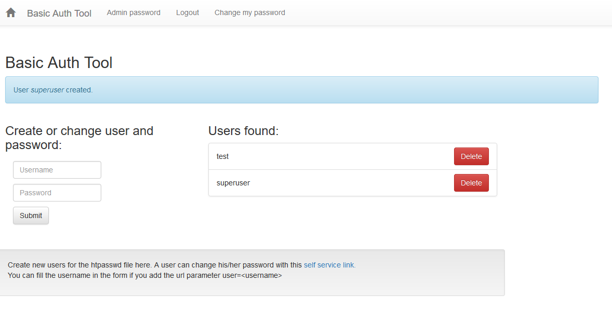

HTAdmin
=======

> **Out of date — do not use as a production tool.**
> This project is out of date and should not be used anymore as-is. It is a
> small, unmaintained experiment that works for local testing only.
>
> Even though it is not recommended to use the original project, the
> dependencies, Docker images and security posture have been updated anyway
> to make it safer for local testing — see
> [Updates](#security-updates) below. Using it beyond that is at your own
> risk; review the shortcomings in [Security](#security-notes) first.

HTAdmin is a simple htpasswd editor implemented in PHP with a small frontend
(based on Bootstrap). It is intended to update and maintain users and
password hashes in an `.htpasswd` file. The admin has to create a user, but
every user can change his/her password by himself using a self-service area.
It is also possible to send a password reset mail. You can use the `.htpasswd`
with nginx and Apache; in the example we use nginx.

It comes with a preconfigured docker compose file, so you don't have to
install a LAMP stack locally for testing.

You find the application in `app/htadmin` and the area to secure for testing
in `app/test`.

Stack
=====

- nginx 1.30 (Debian) + php-fpm 8.5 (Debian), via `nginx.dockerfile` and `php.dockerfile`
- PHPMailer 7.2.0 (vendored in `app/htadmin/phpmailer`)
- jQuery 3.8.0 and Bootstrap 3.4.1 (vendored in `app/htadmin/script` and `app/htadmin/styles`)
- All frontend assets are self-hosted — no CDN dependencies
- Xdebug 3.5.3 is installed in the PHP image but stays disabled unless `PHP_XDEBUG_ENABLED=1` is set in the environment

Malfunctioning states are reported gracefully: if `config/config.ini` does not
exist, every page renders a "Not configured" page instead of PHP warnings.

Setup
=====

Since both the nginx and the php-fpm run as the www-data user, change the
group for the app folder and everything within:

`chgrp -R www-data app`

PHP needs write permission for the user www-data.

Create a config.ini within `app/htadmin/config` from the included example
file `config.ini.example`:

`cp app/htadmin/config/config.ini.example app/htadmin/config/config.ini`

Install a recent docker and the docker compose plugin and run:

`docker compose up -d`

After the build of the PHP image and startup of the containers, point your
browser to:

<http://localhost/htadmin/>

Standard access: admin / admin, make sure to change that in your
`...config/config.ini` for other purposes than testing — the admin hash is a
bcrypt hash of `"admin"` as documented in the example config. You have to
enter a hashed password; there is a tool for its generation included in the
webapp:

<http://localhost/htadmin/adminpwd.php>

The .htaccess and .htpasswd files are configured for this folder:

<http://localhost/test/>

Security updates
================

The following was done when updating the project:

- PHP 8.0 → 8.5, nginx 1.21 → 1.30, xdebug pinned to 3.5.3
- PHPMailer 6.5.0 → 7.2.0, jQuery 1.12.0 → 3.8.0, Bootstrap 3.3.6 → 3.4.1 (all self-hosted, no CDN)
- Password hashing migrated from DES-era `crypt()` to bcrypt (`password_hash()`/`password_verify()`),
  keeping DES and apr1 verification for existing files. Both nginx basic auth and Apache verify bcrypt.
- Hidden files are no longer served (`/.htpasswd`, `/.htmeta`, `.htaccess`) — a critical file leak
  was closed with `nginx.conf` changes
- Password minimum length raised 4 → 8 and enforced in all three flows (admin form, self-service, reset)
- `rand()`/`mt_rand()` replaced with `random_int()`/`random_bytes()` for passwords and salt generation
- Validation errors now name the specific reason (bad username vs. too-short password)
- Security headers, `server_tokens off`, `mime.types` included
- A broken/missing `config.ini` is reported with a clear page instead of PHP warnings

Security notes
==============

Even after the updates, this is not a polished, maintained product. Known
shortcomings worth knowing before any use beyond local testing:

- No HTTPS: everything is plain HTTP on localhost — do not expose it on a network
- No CSRF protection on the mutating forms
- No login rate limiting / lockout — brute-force the admin login freely
- No session rotation (`session_regenerate_id()`) on login
- Password reset mail is reported as "sent" regardless of actual delivery
- DES hashes legacy-only; old DES users still verify DES (8 character limit)
- Bootstrap 3 is itself EOL (last release 2019) — the UI works, but it is stale

To stop the containers: `docker compose down`. To start them again: `docker compose up -d`.

Enjoy!
